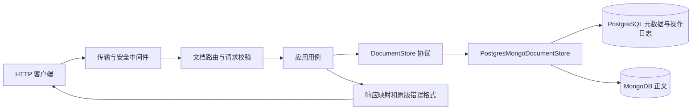

# v1 重构内容与链路闭环报告

> 范围：已完成的 **v1 文档服务**，不是 v1–v21 整个 RAG 系统。事实基准为 2026-10-29 本地验收：NestJS v1 来源提交 `f9dfce20ffe798dc35ede0a74219f06bf3d6980f`，Python v1 验收提交 `75f62ed639f784cac5c2e039ac9afcb622327aa5`，本地 main 合并提交 `d1d4a2703d6be62a4ce11efad9627fe874e897a6`。本报告解释已有代码和证据；报告编写本身不算新一轮业务测试。

## 先看结论和边界

v1 的用户可见路径是：**创建文档 → 列表或详情查询 → 修改 → 软删除 → 再查返回 404**。元数据保存在 PostgreSQL，正文保存在 MongoDB；对外文档 ID 是字符串，PostgreSQL `id` 为 BIGINT，Mongo `documentId` 为对应十进制文本，SQL `content_id` 指向 Mongo `_id`。跨库写入有持久操作日志、条件写入和可重试恢复；HTTP 层保留旧版字段、状态码、错误与传输行为。

README 中的“上传 → 解析 → 向量/图谱 → RAG 问答 → 协作互动”是**最终目标图**。v1 没有上传、RustFS、RabbitMQ、Elasticsearch、Neo4j、LLM、登录或审核；[路线图](../../refactor/roadmap.md)把这些能力放在 v2–v21。当前交付状态以[状态文件](../../refactor/status.md)和 Git 为准。

## 一、七个 Task 分别做了什么，怎样闭环

| Task / 需求 | 实现链路 | 验证出口 |
| --- | --- | --- |
| **1. 固定旧版行为** | 从固定 NestJS v1 源构建隔离服务，以[采集器](../../../scripts/legacy_v1/runner.py)保存请求、响应、PostgreSQL/MongoDB 前后态；[manifest](../../../tests/fixtures/contracts/v1/manifest.json)记录源码和编译产物哈希；[比较器](../../../tests/contract/comparison.py)逐字段核对 | 75 份真实 HTTP/双库样本重放；相同创建时间只允许同组换序，其他数组及字段严格比较。详见[Task1报告](task-1-report.md) |
| **2. 建立可维护的领域基础** | [领域对象](../../../src/knowledge_hub/modules/documents/domain/document.py)、[命令](../../../src/knowledge_hub/modules/documents/domain/commands.py)、[存储端口](../../../src/knowledge_hub/modules/documents/application/ports.py)与 FastAPI/ORM 分离；[文本规则](../../../src/knowledge_hub/modules/documents/domain/text_metrics.py)、[雪花 ID](../../../src/knowledge_hub/core/ids.py)、[配置](../../../src/knowledge_hub/core/config.py)分别负责原版语义 | 旧版 UTF-16 字数/摘要、字符串 ID、配置与边界单测；300/301 行负向门禁。详见[Task2报告](task-2-report.md) |
| **3. 落地双库读取与结构** | [Alembic 迁移](../../../migrations/versions/0001_documents.py)建立兼容的 `kh_document` 及内部日志表；[SQL读取仓储](../../../src/knowledge_hub/modules/documents/infrastructure/metadata_repository.py)、[Mongo正文仓储](../../../src/knowledge_hub/modules/documents/infrastructure/content_repository.py)由[存储实现](../../../src/knowledge_hub/modules/documents/infrastructure/document_store.py)组合；文档锁使用独立连接池 | 原表 23 列、默认值与列型对照；空库升级/降级/再升级、双库关联与分页、索引重复初始化、并发锁和连接池测试。详见[Task3报告](task-3-report.md) |
| **4. 创建、查询与创建恢复** | [创建用例](../../../src/knowledge_hub/modules/documents/application/commands/create_document.py)计算默认值与 ID；[创建计划](../../../src/knowledge_hub/modules/documents/infrastructure/write_create.py)预分配 Mongo `_id` 与操作 ID；[写入协调器](../../../src/knowledge_hub/modules/documents/infrastructure/write_coordinator.py)持锁写双库；[恢复服务](../../../src/knowledge_hub/modules/documents/infrastructure/recovery.py)核对提交结果 | 创建/详情/分页及真实双库故障测试；已提交但回包丢失不误删正文；创建失败补偿留下空标记防迟到写。详见[Task4报告](task-4-report.md) |
| **5. 修改、软删除与完整恢复** | [修改用例](../../../src/knowledge_hub/modules/documents/application/commands/update_document.py)保留“未传/显式 null/同值”；[删除用例](../../../src/knowledge_hub/modules/documents/application/commands/delete_document.py)、[条件写入](../../../src/knowledge_hub/modules/documents/infrastructure/content_mutations.py)与[恢复命令](../../../scripts/recover_document_operations.py)构成修改/删除闭环 | 同正文再次提交、空 PATCH、摘要、发布、并发更新/删除、故障补偿、重启后恢复及 CLI 子进程测试；正常业务软删除保留 Mongo 正文。详见[Task5报告](task-5-report.md) |
| **6. 提供原协议 FastAPI 接口** | [入口](../../../src/knowledge_hub/main.py)→[应用工厂](../../../src/knowledge_hub/app/factory.py)→[HTTP适配](../../../src/knowledge_hub/app/transport.py)→[文档路由](../../../src/knowledge_hub/modules/documents/api/router.py)→用例→存储；[请求](../../../src/knowledge_hub/modules/documents/api/requests.py)、[响应](../../../src/knowledge_hub/modules/documents/api/responses.py)、[错误](../../../src/knowledge_hub/app/error_handlers.py)各自分文件 | 五接口真实 HTTP、75 项双库差分、传输/文本编码补证、连续双库 E2E 与真实 Uvicorn 日志隐私测试。详见[Task6报告](task-6-report.md) |
| **7. 工程验收与合并** | [CI工作流](../../../.github/workflows/quality.yml)、[锁文件](../../../uv.lock)、[运行说明](../../../README.md)和版本化[原版建表夹具](../../../tests/fixtures/legacy_v1/postgresql/init.sql)让干净环境可重现；独立审查后的表单键/数字错误顺序按旧版实测修复 | 全新环境安装、迁移/索引/恢复/正式启动；最终 451 项通过、无跳过、覆盖率 94.71%；合并后关键回归 197 项通过。云端 CI 因无 remote 未运行。详见[验收记录](acceptance.md) |

## 二、一次请求怎样走到两座数据库



1. [入口](../../../src/knowledge_hub/main.py)显式读取配置并启动 Uvicorn；[lifespan](../../../src/knowledge_hub/app/lifespan.py)建立 PostgreSQL 业务池/锁池与 MongoDB 客户端，先 `SELECT 1`、`ping`，退出时关闭。导入 ASGI 模块不连接数据库。启动**不会**偷偷迁移、建索引或执行恢复。
2. [传输层](../../../src/knowledge_hub/app/transport.py)按旧版处理路由大小写/单尾斜杠、请求正文和头；[正文读取器](../../../src/knowledge_hub/app/body_reader.py)处理字符集、有界 gzip/deflate/br 解压、JSON/表单。然后[请求模型](../../../src/knowledge_hub/modules/documents/api/requests.py)及[校验器](../../../src/knowledge_hub/modules/documents/api/validation.py)保留原版字段存在性和错误顺序。
3. [路由](../../../src/knowledge_hub/modules/documents/api/router.py)只调用对应应用用例；[映射器](../../../src/knowledge_hub/modules/documents/api/mappers.py)在外部 `camelCase`、字符串 ID 与内部 `snake_case` 之间转换。领域层只依赖[存储端口](../../../src/knowledge_hub/modules/documents/application/ports.py)，不直接操作 HTTP、SQLAlchemy 或 PyMongo。
4. [存储实现](../../../src/knowledge_hub/modules/documents/infrastructure/document_store.py)把 `kh_document.id`、`kh_document.content_id` 与 Mongo `document_content.documentId`、`_id` 关联；[响应模型](../../../src/knowledge_hub/modules/documents/api/responses.py)返回原版字段和 UTC 毫秒时间。异常交给[错误适配](../../../src/knowledge_hub/app/error_handlers.py)；[安全中间件](../../../src/knowledge_hub/app/safe_errors.py)消费未预期异常，普通日志不打印请求正文。

### 五个对外接口的完整路径

| 接口 | 输入到持久化/读取 | 对外结果与闭环检查 |
| --- | --- | --- |
| `POST /documents` | DTO → 创建用例生成字符串雪花 ID、默认草稿/私有、字数/发布时间 → `prepared` 日志 → Mongo 正文 → PostgreSQL 元数据及 `completed` 同事务提交 | **201**，元数据加 `content`；SQL 的 `content_id` 与 Mongo `_id`、文档 ID 一致，正文初始 `version=1`。[连续 E2E](../../../tests/e2e/test_document_lifecycle.py)和[原版差分](../../../tests/contract/test_v1_replay.py)均验证 |
| `GET /documents` | 查询 DTO → 分页用例 → PostgreSQL 过滤 `deleted=false`、ILIKE/组合条件、计数与分页；**不读取 Mongo 正文** | **200**，`items/total/page/pageSize`；列表 item 不含 `content`。相同创建时间按旧版无次级排序处理，其余顺序严格比较 |
| `GET /documents/{id}` | 字符串 ID → 文档锁与 pending 门禁 → PostgreSQL 元数据 → `contentId` 找 Mongo 正文 | **200**，元数据加 `content`；不存在或已删除为 **404**。旧版正文缺失时返回空 `content`，没有伪造正文记录 |
| `PATCH /documents/{id}` | DTO 保留显式提交字段 → 锁内读取最新双库状态 → 纯变换 → `prepared` → Mongo 条件写入（如需要）→ PostgreSQL 元数据与 `completed` 同事务提交 | **200**，更新后详情；显式提交同一正文仍令 Mongo `version+1`，只改摘要同步 Mongo 摘要而不增版本，空 PATCH/只改元数据不增正文版本。发布转换按原版设置毫秒发布时间 |
| `DELETE /documents/{id}` | 锁内读取 → `prepared` → Mongo/SQL 软删除 → `completed` | **200** `{id,deleted:true}`；再查详情/重复删除 **404**，列表排除；Mongo 业务正文及其版本保留，SQL/Mongo 的 `deleted` 均为 true |

上表中的“闭环”包括响应和双库副作用，不只检查 HTTP 状态。[E2E用例](../../../tests/e2e/test_document_lifecycle.py)连续执行创建、查询、同正文/摘要/空 PATCH/发布、删除、404，并在结束后直接读取两库核对 `contentId`、正文版本、软删除和字数。

## 三、双库写入失败时怎样收口

PostgreSQL 与 MongoDB 没有被伪装成同一个原子事务。写入协议用 PostgreSQL 的 `kh_document_operation` 留下可恢复依据，恢复时用锁和当前双库事实决定结果。

```text
同文档锁 → 拒绝未决操作 → 读取最新状态/建立计划
  → 独立提交 prepared 日志
  → 在业务 SQL 事务中锁住该日志行
  → 条件写 Mongo
  → SQL 元数据 + completed 同事务提交

异常或中断后的新连接/恢复命令：
  锁同一文档 → 新事务取得日志行锁（证明旧 SQL 事务已结束）
  → SQL 已提交且元数据/日志相符：保留成功结果
  → SQL 确认未提交且旧状态相符：条件补偿 Mongo，标记 compensated
  → 无法核验、锁超时或发现外部版本冲突：保留 pending，报告 failed
```

- **为什么要两种锁**：[文档锁](../../../src/knowledge_hub/modules/documents/infrastructure/document_lock.py)使同文档写入串行，并使用独立 PostgreSQL 连接池，避免持锁请求耗尽业务池；[日志行锁](../../../src/knowledge_hub/modules/documents/infrastructure/transaction_fence.py)跨 Mongo 写入到 SQL 提交。恢复的新事务取得此行锁后，才有证据判断旧 SQL 事务已结束。仅捕获到 COMMIT 异常不能判断提交失败。
- **创建失败**：[恢复服务](../../../src/knowledge_hub/modules/documents/infrastructure/recovery.py)确认没有 SQL 元数据后，按本次 `operationId`、`version` 条件把 Mongo 正文变成空的 `deleted/creationFence` 内部标记；保留 `_id`，让迟到的旧 `insert` 无法复活孤立正文。该标记不属于业务软删除，不出现在正常 API。
- **修改/删除失败**：[条件写入](../../../src/knowledge_hub/modules/documents/infrastructure/content_mutations.py)同时匹配 `_id`、`documentId`、公开 `version`、内部 `operationId` 与 `deleted`；[补偿](../../../src/knowledge_hub/modules/documents/infrastructure/recovery_mutations.py)恢复旧公开字段/版本时改用 `rollback:<operation_id>` 新屏障，避免迟到的旧 CAS 再次成功。恢复快照的正文/摘要经[编码模块](../../../src/knowledge_hub/modules/documents/infrastructure/snapshot_encoding.py)保存于受控 SQL 日志，以容纳 Mongo 允许而 PostgreSQL JSONB 不接受的 NUL。
- **无法确认时**：`prepared` 或 `compensation_pending` 保留；[详情和后续同文档写入](../../../src/knowledge_hub/modules/documents/infrastructure/document_store.py)拒绝越过未决门禁，避免把未核验状态当成功。列表仍只读取已提交 SQL 元数据。`last_error` 只保存异常类型，不记录正文或凭据。
- **人工/调度恢复入口**：[CLI](../../../scripts/recover_document_operations.py)按批扫描 pending，输出 `completed/compensated/failed` 计数；有逐条失败时退出 1，配置/连接类整批异常退出 2。重复运行已完成的批次不会再次增加业务版本。服务启动不自动执行该命令，运维需显式安排。

这些不是只靠模拟仓储得出的结论：[创建恢复](../../../tests/integration/documents/test_create_recovery.py)、[创建屏障](../../../tests/integration/documents/test_create_fencing.py)、[修改/删除恢复](../../../tests/integration/documents/test_mutation_recovery.py)、[并发写入](../../../tests/integration/documents/test_concurrent_mutations.py)及[CLI](../../../tests/integration/documents/test_recovery_cli.py)在隔离 PostgreSQL/MongoDB 上验证写入、锁、条件匹配和恢复；故障触发点由测试控制。**未执行**操作系统 kill、整库停机或网络分区演练。

## 四、怎样证明“兼容旧系统”

| 对照层 | 实际做法 | 关键入口 |
| --- | --- | --- |
| 原版身份 | 固定旧后端提交与编译产物 SHA，采集器拒绝覆盖旧证据；原 75 份 expected 不因新实现而改写 | [manifest](../../../tests/fixtures/contracts/v1/manifest.json)、[基线复现](contract-baseline.md) |
| HTTP 与双库 | 每例恢复该例旧版前态，发送同一请求，核对状态/body/字段、SQL 行和 Mongo 正文；动态 ID 按关联绑定，新/变化时间先核对窗口、精度、时区及 API→SQL 关系再归一化 | [重放测试](../../../tests/contract/test_v1_replay.py)、[差分策略](../../../tests/support/v1_compare.py) |
| 传输与错误 | 另存 71 项固定旧版 HTTP 样本，覆盖 JSON/表单/压缩/字符集/路径/HEAD/错误顺序；包括审查发现的根级方括号表单键和数字未知键顺序 | [传输证据](../../../tests/fixtures/contracts/v1-http-boundaries.json)、[传输测试](../../../tests/contract/test_v1_transport.py) |
| 文本编码 | 旧版 JS UTF-16 字数与摘要算法独立验证；SQL/BSON 持久化边界复现 Node 对未配对代理字符的替换 | [文本规则](../../../src/knowledge_hub/modules/documents/domain/text_metrics.py)、[编码证据](../../../tests/fixtures/contracts/v1-text-encoding.json) |
| 允许的内部可靠性增强 | 旧版 071/073 故障样本暴露跨库残留；新实现改为可检测/可恢复状态。HTTP 仍严格对比，内部操作标记先证明归属后才从业务字段差分中排除，正常软删除正文不被忽略 | [兼容说明](../../contracts/v1.md)、[验收记录](acceptance.md) |

这里的“严格兼容”指 **v1 已固定、采集并测试的接口与双库行为**。有限样本不能证明所有畸形 HTTP/Unicode 组合都已穷举；原系统的跨库不一致历史缺陷也不是新系统需要复制的目标。

## 五、部署与工程交付链路

1. [README](../../../README.md)按实际执行顺序给出：`uv.lock` 锁定安装 → 专用测试双库 → 独立空应用库迁移 → Mongo 索引初始化 → 恢复命令 → `python -m knowledge_hub.main --env-file ...` 启动 → 五接口与两库核对 → 停止专用容器。空库 Alembic 升级→降级→升级、Mongo 索引重复运行和真实 TCP 服务均已实测。
2. [质量工作流](../../../.github/workflows/quality.yml)将格式、lint、mypy strict、300 行门禁、锁文件检查和带双库开关的全套测试写成可重复步骤。工作流 YAML/Compose 配置已在本地解析；仓库没有 remote，**云端 Actions 未运行**。
3. [AGENTS](../../../AGENTS.md)只保留硬规则和阅读入口；细节由[开发SOP](../../refactor/agent-sop.md)、[架构](../../refactor/architecture.md)、[代码规范](../../refactor/code-standards.md)、[兼容策略](../../refactor/compatibility.md)、[路线图](../../refactor/roadmap.md)、[状态](../../refactor/status.md)渐进披露。新会话先核对 Git，再从状态指向的版本规格/计划继续。
4. 版本流转为 `main → v1 → 验收 → main`。v1 已以 `--no-ff` 本地合并，验收分支保留；合并后[契约与 E2E](acceptance.md)再跑 197 项通过。当前 main HEAD 可能因文档提交继续前进，应以 Git 查询为准；v2 必须从更新后的 main 派生。

## 六、验收证据与仍需处理的事

| 验收项 | 已记录的结果 |
| --- | --- |
| 最终完整测试 | 2026-10-29，新锁定 Python 环境与全新隔离双库，**451 passed、0 skipped、94.71%**；单元、集成、契约、E2E 同跑，覆盖率门槛 85%。原始命令、环境和日志位置见[验收记录](acceptance.md) |
| 合并后关键回归 | main 合并树与 v1 验收树相同；契约/E2E **197 passed、0 skipped** |
| 代码质量 | Ruff 格式与 lint、mypy strict 94 文件、uv 锁检查均通过；91 个生产/脚本 Python 文件最长 **137/300** 物理行 |
| 运行与资源 | 真实模块入口五接口、OpenAPI、PostgreSQL/MongoDB 关联验证通过；测试临时 schema/集合各 0 残留，专用容器已停止并保留卷 |

**仍需明确安排**：旧业务库已有无版本表时，v1 迁移会拒绝静默覆盖，正式切换需要单独审核 baseline/导入方案；生产多进程需唯一 Snowflake worker ID、连接池预算、恢复命令调度和 SQL 快照访问控制；OS kill/整库停机/网络分区未演练；仓库无 remote，因此没有云端 CI、推送或发布。v2 的文件上传/解析/RustFS 仍未开始，不能把最终 RAG 目标图当成当前功能。

若要逐项核对证据，从[验收记录](acceptance.md)进入；若要继续下一版，从[当前状态](../../refactor/status.md)与[开发SOP](../../refactor/agent-sop.md)进入。后续版本按[决策 D032](../../refactor/decisions.md)提供同名链路报告，不把未完成路径写成已闭环。
