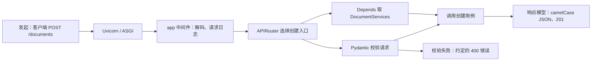
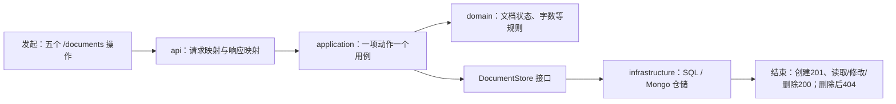
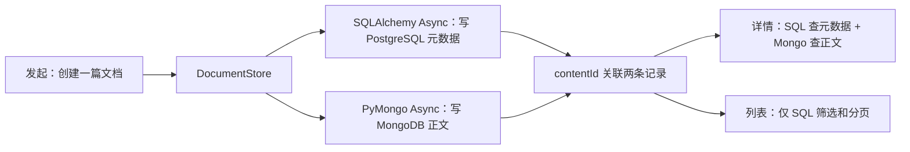
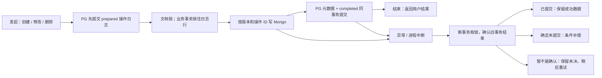

# v1 文档服务学习讲义

这是一堂“用 FastAPI 完成第一个知识库后端模块”的课。学完本版，应能沿着一次文档请求，指出请求在哪里校验、业务规则在哪里执行、两种数据库分别保存什么，以及写到一半失败时如何收尾。v1 已完成的是**文档服务**；上传、解析、检索和 RAG 问答属于[后续版本](../../refactor/roadmap.md)。

本讲义讲实现思路和代码入口；逐例运行记录、命令与测试边界见[验收记录](acceptance.md)。本次只改讲义，没有重跑业务测试。

## 1. 本版学会了哪些需求闭环

| 学习主题 | 用户能完成的事 | 本版对应的技术要点 |
| --- | --- | --- |
| **HTTP 接口与契约** | 用原有 `/documents` 接口发请求，收到约定的状态码、字段和错误。 | FastAPI 路由、Pydantic 请求/响应模型、依赖注入、ASGI 中间件与异常处理。 |
| **文档完整生命周期** | 创建文档 → 列表和详情 → 修改 → 软删除 → 再查询得到 404。 | 每个动作一个应用用例；领域对象保存业务数据；路由只负责交接输入和输出。 |
| **双库存储** | 文档元数据和正文分别保存，详情能把它们重新组合。 | SQLAlchemy Async 操作 PostgreSQL，PyMongo Async 操作 MongoDB，以 `contentId` 关联。 |
| **跨库写入恢复** | 某一步失败后，系统能核对结果并恢复到可解释的状态。 | 持久操作日志、文档锁、条件写入、SQL 提交核对、补偿与可重试恢复命令。 |
| **可接续的工程** | 安装、初始化、启动、验证这套服务，并找到下一版的起点。 | `uv` 锁定依赖、Alembic、生命周期管理、测试与质量门禁、版本记录。 |

可以用一篇“FastAPI 学习笔记”贯穿本课：`POST /documents` 保存标题和正文，`GET` 找回它，`PATCH` 改正文，`DELETE` 将它隐藏。下面先给出代码地图，再逐步追踪这篇文档。

## 2. 文件树：到哪里读代码

把项目想成一条流水线：**外层接 HTTP，中间做业务，内层访问存储**。先看目录职责，再顺着第 3 节的图打开文件；不需要逐个读完 259 个文件。

```text
knowledge-hub-fastapi/
├── README.md / AGENTS.md                 运行入口、开发规则
├── pyproject.toml / uv.lock / .env.example 依赖、工具配置、环境变量样例
├── src/knowledge_hub/
│   ├── main.py                            Uvicorn 启动入口
│   ├── app/
│   │   ├── factory.py / lifespan.py       创建 FastAPI 应用；启动和关闭资源
│   │   ├── transport.py / body_reader.py  请求传输与有界解码
│   │   └── error_handlers.py / responses.py 错误与 JSON 输出
│   ├── core/                              配置、时钟、字符串 ID、日志
│   ├── integrations/postgres/             SQLAlchemy 连接与会话
│   ├── integrations/mongodb/              PyMongo Async 客户端
│   └── modules/documents/
│       ├── api/                           路由、Pydantic 模型、依赖与映射
│       ├── application/commands/          创建、修改、删除用例
│       ├── application/queries/           详情、分页用例
│       ├── application/ports.py           应用层要求的存储接口
│       ├── domain/                        文档数据与纯文本规则
│       └── infrastructure/                双库仓储、写入协调、日志与恢复
├── migrations/versions/0001_documents.py PostgreSQL 表结构
├── scripts/init_mongo_indexes.py         MongoDB 索引初始化
├── scripts/recover_document_operations.py 未决操作恢复命令
├── scripts/check_file_limits.py          Python 单文件行数门禁
├── deploy/compose.test.yml               隔离的测试双库
├── tests/{unit,integration,contract,e2e}/ 规则、真实库、接口契约、完整用户路径
├── tests/fixtures/                     固定请求/响应与数据库样本
├── .github/workflows/quality.yml         质量检查流程
└── docs/versions/v1/                     规格、各阶段报告、验收与本讲义
```

**本版新增/修改的范围**：相对初始空 `main`（`5e43438`），v1 新增 **259** 个受版本控制文件，没有在该基准上修改既有文件；树里合并展示了重复的 `__init__.py` 与测试样本。v1 验收合并后，为说明交付情况又新增了本讲义，修改了 README、AGENTS、SOP、状态、决策、模板和验收等文档；业务代码、迁移、测试及依赖锁没有随报告改动。本次重新授课式编写也只涉及文档。

**阅读顺序**：先读 [router.py](../../../src/knowledge_hub/modules/documents/api/router.py) 看五个入口，再读 [create_document.py](../../../src/knowledge_hub/modules/documents/application/commands/create_document.py) 看用例，最后读 [document_store.py](../../../src/knowledge_hub/modules/documents/infrastructure/document_store.py) 看双库如何落地。这样能先建立请求主线，再研究恢复细节。

## 3. 跟着一次请求理解每项需求的实现链路

### 3.1 接口层：HTTP 请求如何进入 FastAPI

先看最小例子：客户端向 `POST /documents` 发送 `{"title":"FastAPI 学习笔记","content":"第一段正文"}`。请求经过 ASGI 中间件和路由；FastAPI 完成请求模型校验与依赖注入，业务动作由用例函数完成。



**这里的 FastAPI 知识点**：[factory.py](../../../src/knowledge_hub/app/factory.py) 创建应用并挂载中间件、异常处理和路由；[router.py](../../../src/knowledge_hub/modules/documents/api/router.py) 用装饰器声明路径与方法；[dependencies.py](../../../src/knowledge_hub/modules/documents/api/dependencies.py) 用 `Depends` 注入同一生命周期创建的存储、时钟和 ID 生成器。[requests.py](../../../src/knowledge_hub/modules/documents/api/requests.py) 用 Pydantic 描述输入，[responses.py](../../../src/knowledge_hub/modules/documents/api/responses.py) 把内部 `snake_case` 映射为外部 `camelCase`。

**为什么还有协议适配层**：FastAPI 默认的校验错误、JSON 编码和请求体解析不一定等于项目已有接口。[transport.py](../../../src/knowledge_hub/app/transport.py)、[body_reader.py](../../../src/knowledge_hub/app/body_reader.py)及[error_handlers.py](../../../src/knowledge_hub/app/error_handlers.py)处理请求编码、表单、压缩、错误格式等边界。结束时不只看“能返回 200”：固定的[75 份接口与双库样本](../../../tests/fixtures/contracts/v1/manifest.json)和补充的 71 份传输样本逐项核对输入、状态码、JSON 与数据副作用；差分入口在[重放测试](../../../tests/contract/test_v1_replay.py)。

### 3.2 文档生命周期：创建、读取、修改、删除各做什么

应用层的一个函数对应一个动作。例如 `create_document()` 接受已经校验过的命令，产生 ID、默认草稿状态、字数和时间，然后调用 `DocumentStore`；它不认识 FastAPI 的 `Request`，也不自己写 SQL。`DocumentStore` 是应用层定义的接口，实际的 PostgreSQL + MongoDB 实现在基础设施层。



| 操作 | 从入口到结束的具体流转 |
| --- | --- |
| **创建** `POST /documents` | [create_document.py](../../../src/knowledge_hub/modules/documents/application/commands/create_document.py) 计算 ID、默认值、字数 → 存储层保存元数据和正文 → 返回带字符串 ID、标题和正文的 201 响应。 |
| **列表** `GET /documents` | [list_documents.py](../../../src/knowledge_hub/modules/documents/application/queries/list_documents.py) 交给 SQL 仓储做筛选、排序、分页 → 返回 `items/total/page/pageSize`，列表不读取 Mongo 正文。 |
| **详情** `GET /documents/{id}` | [get_document.py](../../../src/knowledge_hub/modules/documents/application/queries/get_document.py) 按 ID 找 SQL 元数据，再用 `contentId` 取 Mongo 正文 → 拼成详情；找不到则 404。 |
| **修改** `PATCH /documents/{id}` | [update_document.py](../../../src/knowledge_hub/modules/documents/application/commands/update_document.py) 根据明确提交的字段改值；“未提交”和“提交 null”分开处理。显式提交 `content` 即使文本未变，也按规则令正文版本加 1。 |
| **软删除** `DELETE /documents/{id}` | [delete_document.py](../../../src/knowledge_hub/modules/documents/application/commands/delete_document.py) 触发双库删除标记，保留存储记录；之后列表不展示该文档，详情返回 404。 |

这里最值得练习的是**职责边界**：路由负责 HTTP，用例负责业务动作，[document.py](../../../src/knowledge_hub/modules/documents/domain/document.py) 保存不依赖框架的文档模型，[document_store.py](../../../src/knowledge_hub/modules/documents/infrastructure/document_store.py) 实现存取。[连续 E2E 测试](../../../tests/e2e/test_document_lifecycle.py)把这五步连起来，验证用户看到的结果和数据库实际状态一致。

**两个容易忽略的规则**：外部 ID 是十进制字符串，生成逻辑集中在 [ids.py](../../../src/knowledge_hub/core/ids.py)；字数与正文摘要遵循原有 JavaScript 文本语义，纯计算放在 [text_metrics.py](../../../src/knowledge_hub/modules/documents/domain/text_metrics.py)。因此路由无需知道雪花 ID 位布局，也无需在每个接口复制文本算法。

### 3.3 双库存储：一篇文档为什么要访问两个数据库

文档标题、状态、作者、删除标记等元数据放在 PostgreSQL；正文及正文版本放在 MongoDB。SQL 行中的 `contentId` 指向 Mongo 记录。这样读取列表时只需要查 SQL，读取详情时才需要组合两库数据。这个存储分工是本项目的既定架构，代码不能把正文偷偷改存到 SQL。



连接在 [lifespan.py](../../../src/knowledge_hub/app/lifespan.py) 的 FastAPI 生命周期里创建：启动时检查 PostgreSQL 和 MongoDB，装配 `PostgresMongoDocumentStore`；关闭时释放连接。这比每次请求重新建连接更可控。SQL 表由 [Alembic 迁移](../../../migrations/versions/0001_documents.py)建立，Mongo 唯一索引由[初始化脚本](../../../scripts/init_mongo_indexes.py)建立；两者都是**显式执行的准备步骤**，应用启动只检查连通性，不自动改表或恢复。已有无版本业务库需要另行制定导入方案。

### 3.4 跨库一致性：写到一半失败时怎么办

PostgreSQL 和 MongoDB 各有自己的事务，不能假设写完 Mongo 就一定能提交 SQL。以修改正文为例：Mongo 已更新，而 SQL 提交回包丢失，此时客户端只知道“调用异常”，不知道 SQL 究竟成功还是失败。如果立刻把 Mongo 改回旧值，可能会撤销一笔其实已经成功的修改。



**实现抓手**：[operation_journal.py](../../../src/knowledge_hub/modules/documents/infrastructure/operation_journal.py)先持久保存操作身份和恢复依据；[document_lock.py](../../../src/knowledge_hub/modules/documents/infrastructure/document_lock.py)避免同一文档并发写打架；[write_coordinator.py](../../../src/knowledge_hub/modules/documents/infrastructure/write_coordinator.py)与[mutation_writer.py](../../../src/knowledge_hub/modules/documents/infrastructure/mutation_writer.py)组织双库写入；[recovery.py](../../../src/knowledge_hub/modules/documents/infrastructure/recovery.py)核对并决定保留还是补偿。Mongo 条件写入比较版本和操作 ID，防止恢复过程覆盖更新的数据。创建失败时留下内部空标记，阻止迟到的插入再次制造孤立正文。

**结束条件**不是“捕获了异常”，而是操作最终被确认完成、确认补偿，或者安全地保持未决。未决记录可由[恢复命令](../../../scripts/recover_document_operations.py)重试；确认不了 SQL 状态时不会猜测。这一链路有真实双库、并发和故障测试，具体证据见[验收记录](acceptance.md)。

### 3.5 工程链路：服务怎样从代码变成可运行版本


从学习角度看，[main.py](../../../src/knowledge_hub/main.py) 是进程入口，[factory.py](../../../src/knowledge_hub/app/factory.py) 是 FastAPI 应用装配处，[lifespan.py](../../../src/knowledge_hub/app/lifespan.py) 是资源生命周期边界。[README](../../../README.md)给出锁定安装、初始化、启动和测试命令；[质量工作流](../../../.github/workflows/quality.yml)把格式、lint、严格类型、300 行限制和测试放在一起。v1 已在隔离双库上完整验证，并从 `v1` 分支本地合并到 `main`；仓库无 remote，云端 CI 尚未运行。

## 4. 本课总结

理解 v1 的关键，不是背下所有文件名，而是能回答三个问题：**请求从哪里进来？业务规则在哪一层？两库写入中断后依据什么恢复？** 对照本讲义中的代码入口，沿一篇文档的创建、读取、修改和删除路径走一遍，就能看到 FastAPI 路由、Pydantic、依赖注入、应用用例、仓储与生命周期如何合作。

本版此前的完整验收为 **451 项通过、0 跳过、覆盖率 94.71%**；合并后关键回归 **197 项通过**。这些数字来自[验收记录](acceptance.md)，本次改讲义未重跑业务测试。v2–v21、旧业务库正式切换、整库停机或网络分区演练、云端 CI 与发布仍未完成；下一版从[当前状态](../../refactor/status.md)继续。
