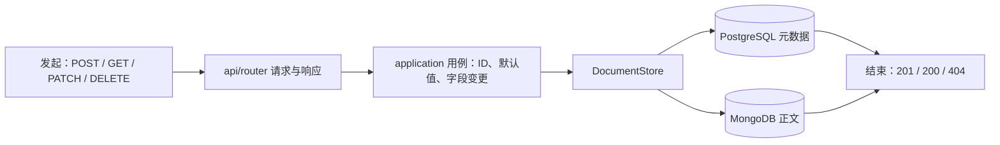
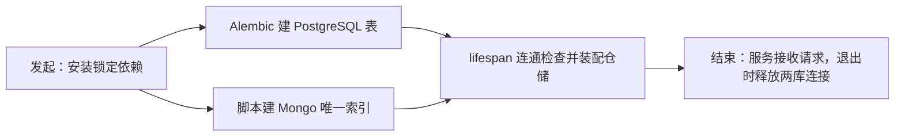
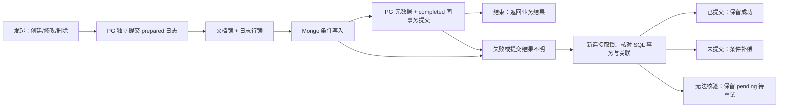

# v1 重构交付报告

> 范围：已交付的 v1 文档服务。NestJS 来源提交 `f9dfce2`；Python v1 验收提交 `75f62ed`，本地 main 合并提交 `d1d4a27`。下文的测试数字来自[v1 验收记录](acceptance.md)，本次整理报告没有重跑业务测试。

## 1. 这次版本完成的需求闭环

| 需求 | 闭环结果 |
| --- | --- |
| **旧接口兼容** | 固定旧版请求、响应及双库状态；新服务保持五个文档接口的字段、状态码和错误行为。75 项 HTTP/双库证据及 71 项传输证据通过对照。 |
| **文档 CRUD** | 创建 → 列表/详情 → 修改 → 软删除 → 再查 404；外部 ID 为字符串，JSON 为 `camelCase`。连续真实双库 E2E 核对正文版本与删除状态。 |
| **PostgreSQL + MongoDB** | PostgreSQL 存元数据，MongoDB 存正文；`contentId` 关联两库。空库迁移、Mongo 索引初始化及双库读取已验证。 |
| **跨库失败恢复** | 写入前保存操作日志；提交结果不明时核对 SQL 事务，再保留成功结果、条件补偿或等待重试。并发、补偿失败和恢复命令均有真实库测试。 |
| **工程交付** | 模块拆分、锁定依赖、300 行门禁、CI 工作流与运行说明；本地验收后合并 main。云端 CI 因无 remote 未运行。 |

v1 **没有**实现上传、解析、检索或 RAG 问答；这些是[后续版本](../../refactor/roadmap.md)的范围。

## 2. 文件树：新增和修改了什么

Git 对比 `5e43438（初始空 main）→ v1`：**259 个新增文件、0 个相对起点的修改文件**。下面是功能文件树；省略重复的 `__init__.py` 和 75 份逐例 JSON 文件名，数量单列，职责不省略。

```text
knowledge-hub-fastapi/
├── AGENTS.md / README.md                 规则入口、业务闭环和实测运行说明
├── .gitattributes / .gitignore / .python-version / alembic.ini
│                                         Git、Python 与迁移工具配置
├── pyproject.toml / uv.lock / .env.example 依赖、质量门禁、配置示例
├── typings/brotli.pyi                    HTTP 压缩库的精确类型声明
├── .github/workflows/quality.yml         CI 质量流程
├── deploy/compose.test.yml               隔离 PostgreSQL/MongoDB
├── migrations/
│   ├── env.py                             拒绝无版本旧表的迁移入口
│   └── versions/0001_documents.py         文档元数据与操作日志表
├── src/knowledge_hub/                     v1 共 77 个 Python 文件
│   ├── main.py                            服务入口
│   ├── app/
│   │   ├── factory.py / lifespan.py       应用装配、双库连接与关闭
│   │   ├── transport.py / body_reader.py / form_body.py / json_*.py
│   │   │                                  旧版 HTTP、编码、JSON/表单行为
│   │   └── error_handlers.py / safe_errors.py / openapi.py
│   │                                      原错误、异常脱敏、接口文档
│   ├── core/{config,clock,ids,identifiers,errors,logging}.py
│   │                                      配置、时钟、雪花 ID、错误、日志
│   ├── integrations/{postgres,mongodb,http}/
│   │                                      PostgreSQL、MongoDB、HTTP 压缩客户端
│   └── modules/documents/
│       ├── api/{router,requests,responses,mappers,validation,
│       │        dependencies,query_numbers,query_schema}.py
│       │                                  路由、请求/响应、映射和校验
│       ├── application/commands/{create_document,update_document,delete_document}.py
│       ├── application/queries/{get_document,list_documents}.py / ports.py
│       │                                  创建/修改/删除/查询用例与存储端口
│       ├── domain/{document,commands,text_metrics}.py
│       │                                  文档模型、命令、旧版文本规则
│       └── infrastructure/
│           ├── {document_store,metadata_repository,content_repository,
│           │    document_row,content_record,mappers}.py       双库仓储与映射
│           ├── {write_coordinator,write_create,write_update,write_delete,
│           │    mutation_writer,mutation_plan,content_mutations}.py  写入计划
│           └── {operation_journal,operation_row,operation_types,document_lock,
│                transaction_fence,recovery,recovery_mutations,
│                snapshot_encoding}.py                         日志、锁、恢复
├── scripts/                               v1 共 14 个文件
│   ├── legacy_v1/ / capture_legacy_v1.py  旧服务证据采集
│   ├── init_mongo_indexes.py              Mongo 索引
│   ├── recover_document_operations.py     未决操作恢复
│   └── check_file_limits.py               300 行门禁
├── tests/                                 v1 共 131 个文件
│   ├── unit/ (14) / integration/ (20) / contract/ (10) / e2e/ (1)
│   ├── fixtures/ (79)                    原版快照、传输/编码、建表夹具
│   └── support/ (5)                      双库隔离与差分工具
└── docs/ (v1 共 23 个文件)                规格、契约、决策、SOP、Task 报告和验收
```

**合并后新增/修改**：本文件 `docs/versions/v1/implementation-flow-report.md` 为新增；`AGENTS.md`、`README.md`、`docs/refactor/{agent-sop,decisions,roadmap,status,work-log}.md`、`docs/templates/version-record.md`、`docs/versions/v1/acceptance.md`、`docs/superpowers/plans/2026-10-28-v1.md` 为文档修改。`v1 → 当前 main` 的 `src/`、`scripts/`、`migrations/`、`tests/`、依赖锁与 CI 配置**没有生产或测试代码差异**。

## 3. 每项需求的实现链路

### 3.1 旧接口兼容：从旧版证据到新响应


[原版清单](../../../tests/fixtures/contracts/v1/manifest.json)锁定源码与构建身份；[传输层](../../../src/knowledge_hub/app/transport.py)、[请求校验](../../../src/knowledge_hub/modules/documents/api/requests.py)和[错误适配](../../../src/knowledge_hub/app/error_handlers.py)处理差异。[重放测试](../../../tests/contract/test_v1_replay.py)不把新服务输出反写成旧版期望；旧版跨库残留缺陷单独记录并做可靠性增强。

### 3.2 文档 CRUD：从请求到用户可见结果



[路由](../../../src/knowledge_hub/modules/documents/api/router.py)只编排用例；[创建](../../../src/knowledge_hub/modules/documents/application/commands/create_document.py)、[修改](../../../src/knowledge_hub/modules/documents/application/commands/update_document.py)、[删除](../../../src/knowledge_hub/modules/documents/application/commands/delete_document.py)分别负责业务规则；[存储实现](../../../src/knowledge_hub/modules/documents/infrastructure/document_store.py)读写两库。列表只查 SQL 元数据，详情再取 Mongo 正文；显式提交相同正文仍令正文版本加 1；软删除保留正文而隐藏文档。完整连续路径见[E2E 测试](../../../tests/e2e/test_document_lifecycle.py)。

### 3.3 双库存储：从显式初始化到可读写



[迁移](../../../migrations/versions/0001_documents.py)保留原文档表 23 列并增加内部操作日志；[索引脚本](../../../scripts/init_mongo_indexes.py)可重复运行；[生命周期](../../../src/knowledge_hub/app/lifespan.py)检查连接并关闭客户端。启动**不会**自动迁移、建索引或恢复；已有无版本业务库必须另做导入方案，不能静默覆盖。

### 3.4 跨库恢复：从失败现场到确定状态



[操作日志](../../../src/knowledge_hub/modules/documents/infrastructure/operation_journal.py)保存恢复依据；[文档锁](../../../src/knowledge_hub/modules/documents/infrastructure/document_lock.py)保护同文档并发；[恢复服务](../../../src/knowledge_hub/modules/documents/infrastructure/recovery.py)只在确认旧 SQL 事务结束后补偿。创建补偿留空标记防迟到插入，修改/删除用版本与操作 ID 条件写入防覆盖较新正文；[恢复命令](../../../scripts/recover_document_operations.py)可重试未决记录，不把未知提交当失败删除。

### 3.5 工程交付：从版本分支到 main


[质量工作流](../../../.github/workflows/quality.yml)串起格式、lint、严格类型、300 行限制和测试；[验收记录](acceptance.md)保存命令、差异与限制。v1 已用 `--no-ff` 合并；后续 v2 必须从更新后的 main 派生。仓库无 remote，工作流文件存在不等于云端 CI 已运行。

## 4. 总结

v1 的**业务闭环**是创建、查询、修改、软删除及对应双库状态；**可靠性闭环**是写前日志、条件写入、提交核对和可重试恢复；**工程闭环**是固定旧版证据、质量门禁、真实双库验收与本地 main 合并。最终完整回归 **451 项通过、0 跳过、覆盖率 94.71%**，合并后关键回归 **197 项通过**；这些是此前验收结果，本次只重写报告。

未完成的范围：v2–v21 功能、旧业务库正式切换、整库停机/网络分区演练，以及云端 CI、推送和发布。下一版入口见[当前状态](../../refactor/status.md)，更细的原始证据与命令见[验收记录](acceptance.md)。
